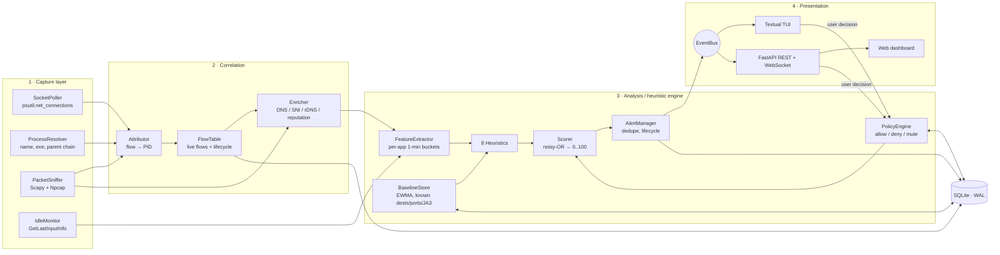

# 1. System Architecture

## 1.1 Purpose

NetSentry is a single-host daemon. It attributes every network connection on the machine to the process that owns it, builds a behavioural baseline for each application, and flags deviations using explainable heuristics. Every alert answers three questions: **which app**, **what it did**, and **why that is unusual for this app**.

### Goals
- G1: Attribute each TCP/UDP flow to a process (PID, executable, parent chain).
- G2: Record per-flow metadata over time: remote IP, domain, port, protocol, bytes, timing.
- G3: Score behaviour with 8 independent, unit-testable heuristics that are tunable from a config file.
- G4: Show live per-app severity and a per-app history, and persist alerts across runs.
- G5: Let the user's allow/deny/mute decisions feed back into the engine.
- G6: Run on one Windows laptop with no extra infrastructure. Degrade gracefully when not run as admin.

### Non-goals
Payload or TLS decryption, a malware signature database, kernel drivers, and blocking traffic. Blocking through the Windows Firewall is an optional stretch goal and is never automatic.

## 1.2 Reconciling the report and the slides

The DA2 report lists JA3 under *future scope*, but slide 6 moves **JA3 fingerprinting** and **process lineage** into scope. This design follows the slides, so the engine has **8 heuristics**: the original six, plus *suspicious process lineage* and *TLS fingerprint novelty*. Both are cheap to build because we already need parent-process lookups and TLS ClientHello parsing (for SNI).

## 1.3 Layered architecture



The report described three layers. In this design the middle **correlation** stage gets its own layer, because joining packets to sockets to processes is the hardest part of the project and has to be testable on its own.

| Layer | Responsibility | Input → Output | Testable in isolation by |
|-------|----------------|----------------|--------------------------|
| Capture | Read raw OS state and packets | OS → `SocketEntry`, `ProcessInfo`, `PacketStat`, `DnsAnswer`, `TlsHello`, idle seconds | Run `netsentry capture --dump` and compare with `netstat -ano` |
| Correlation | Turn samples into attributed, enriched flows | samples → `Flow` (with PID, app, domain, bytes) | Replay recorded ticks and assert on the flow table |
| Analysis | Features, baseline, heuristics, score, alerts | flows → `Verdict` per app, `Alert` | Unit tests with synthetic feature vectors |
| Presentation | Show state, take user decisions | events → UI; clicks → `PolicyRule` | Run against the replay mode, with no live capture |

## 1.4 Components

| Component | Module | Notes |
|-----------|--------|-------|
| SocketPoller | `capture/socket_poller.py` | `psutil.net_connections(kind="inet")` every `poll_interval` (default 2 s). Runs in a worker thread. |
| ProcessResolver | `capture/process_resolver.py` | Cache keyed by `(pid, create_time)`, because PIDs get reused. Resolves name, exe path, username, cmdline and the parent chain (up to 4 levels). Handles `AccessDenied` by keeping partial info. |
| PacketSniffer | `capture/sniffer.py` | Scapy `AsyncSniffer` on Npcap, with `store=False` and a BPF filter `ip or ip6`. Counts bytes and packets per 5-tuple. Parses DNS responses (UDP 53) and TLS ClientHello (first data packet of TCP/443-like flows). **Optional:** requires admin. |
| TLS parser | `capture/tls.py` | Extracts SNI, JA3 and **normalised JA3** (extensions sorted, GREASE removed). Chrome randomises extension order, so raw JA3 is unstable. |
| IdleMonitor | `capture/idle.py` | `ctypes` call to `GetLastInputInfo`. Gives "seconds since the user last touched the keyboard or mouse". |
| Attributor | `pipeline/attributor.py` | Joins sniffer 5-tuples to socket-table entries. Uses an exact 5-tuple match for TCP and a `(proto, local_port)` match for UDP. |
| FlowTable | `pipeline/flow_table.py` | Live flows. A flow opens when first seen and closes after 2 polls in which it is missing. Holds counters and timestamps. |
| Enricher | `pipeline/enricher.py` | Resolves a domain for each remote IP: DNS cache, then SNI, then async reverse DNS. Reputation lookup (AbuseIPDB) is a stretch goal. |
| FeatureExtractor | `detection/features.py` | Rolls flows into per-app **1-minute buckets** and a 5-minute sliding window. |
| BaselineStore | `detection/baseline.py` | Per app: EWMA mean/variance of each bucket feature, known destinations, known ports, known JA3s, a 24-bin activity histogram, and maturity. |
| Heuristics | `detection/heuristics/*.py` | 8 pure functions `(features, baseline, ctx) → HeuristicResult(score 0..1, evidence)`. |
| PolicyEngine | `detection/policy.py` | Applies allow/deny/mute rules before and after scoring. |
| Scorer | `detection/scorer.py` | Combines heuristic results into a 0–100 score and a severity. |
| AlertManager | `detection/alerts.py` | Opens, updates, de-duplicates and resolves alerts. Writes them to SQLite. |
| EventBus | `bus.py` | An in-process async pub/sub. The UI layers subscribe to it, and the core never imports a UI module. |
| Storage | `storage/` | SQLite in WAL mode. One writer task with batched inserts per tick. |
| TUI | `ui/tui/` | Textual app. It is the MVP presentation layer. |
| API + Web | `ui/api/`, `web/` | FastAPI on `127.0.0.1:8765` with REST and a WebSocket, plus a Vite + React dashboard. This is a stretch goal. |

## 1.5 Runtime model

One Python process, `netsentry run`, with:

```
main thread ── asyncio event loop
   ├─ Engine.tick() every poll_interval (2 s)       ← orchestrates the pipeline
   │     ├─ run_in_executor(SocketPoller.poll)       ← blocking psutil call, in a thread
   │     ├─ drain sniffer queue
   │     ├─ attribute → flow table → enrich → features → score → alerts
   │     └─ bus.publish(TickResult)
   ├─ BaselineUpdater every bucket close (60 s)
   ├─ StorageWriter (batched, one transaction per tick)
   ├─ Enricher async rDNS / reputation lookups (bounded concurrency, cached)
   └─ UI: Textual app OR uvicorn server (same loop)

sniffer thread ── Scapy AsyncSniffer callback
   └─ aggregates into a dict[FlowKey, Counters] under a lock; DNS/TLS events → queue
```

Design rules:
- Only the asyncio loop mutates engine state, so the engine needs no locks. The sniffer thread only writes to its own counter dict and a queue, which the engine swaps out atomically on each tick.
- Every time-dependent component takes a `Clock`. Replay and tests inject a fake clock, which makes every run deterministic.
- The engine is UI-agnostic. `--ui tui`, `--ui web` and `--ui none` (headless and log only) all reuse the same core.

## 1.6 Privilege modes

| | **Standard mode** (no admin) | **Full mode** (admin + Npcap) |
|---|---|---|
| Socket table and PIDs | ✅ | ✅ |
| Process names / exe | ✅ (some system PIDs are `AccessDenied` and shown as `pid:1234`) | ✅ |
| Parent chain (lineage) | ✅ | ✅ |
| Per-flow bytes | ❌ | ✅ |
| DNS names / SNI | rDNS only | ✅ DNS answers + SNI |
| JA3 | ❌ | ✅ |
| Heuristics available | port, frequency, new-dest, blocklist, off-hours, lineage (6) | all 8 |

The scorer knows which heuristics were *unavailable*, and the UI shows the current mode. Data that is missing never counts as evidence that the app is safe. The UI simply says "volume: n/a (standard mode)".

## 1.7 Key design decisions

| # | Decision | Alternatives considered | Why |
|---|----------|------------------------|-----|
| D1 | **Python 3.13** for the whole core | Node.js | psutil, Scapy and Textual cover all three layers in one language, and the report already commits to it. |
| D2 | **Poll the socket table** for attribution, plus an **optional sniffer** for bytes and names | ETW kernel-network provider; `GetPerTcpConnectionEStats` | psutil works without admin and is cross-platform. ETW gives exact per-PID bytes but needs admin and is complex to consume from Python. Npcap is already installed. |
| D3 | **1-minute buckets + EWMA baselines** | Raw-event windows; full history recompute | O(1) memory per app, simple to explain, and easy to persist. |
| D4 | **Noisy-OR combination** of heuristic scores | Plain weighted average | With a weighted average, one strong signal gets diluted by seven quiet ones. With noisy-OR, each heuristic's weight is "the most this signal alone can contribute", and independent signals reinforce each other. It is still a single readable formula (see doc 4). |
| D5 | **SQLite (WAL)** | JSON files | It needs no server, supports queries for history views, and is safe to read from the API while the engine writes. |
| D6 | **Textual TUI first, web second** | Web first | The TUI is the fastest route to an end-to-end demo. The web layer reuses the same EventBus. |
| D7 | **Record/replay** of raw ticks as JSONL | Live-only testing | Gives deterministic tests, a safe demo even with no network, and lets us tune thresholds offline. |
| D8 | **Normalised JA3** next to raw JA3 | JA4 | Chrome randomises extension order, so raw JA3 is unstable. Sorting extensions keeps the idea of JA3 and stays stable. Full JA4 is future work. |
| D9 | App identity is the **lower-cased exe path**, not the name | Process name | Any binary can be called `chrome.exe`. A path in `%TEMP%` is a different app, and that fact is itself a lineage signal. |

## 1.8 Known limitations (stated honestly in the report)

- **Short-lived connections** that open and close between two polls are invisible in standard mode. In full mode the sniffer still sees their packets, but if the socket is already gone they are attributed to `unknown`.
- **QUIC / HTTP3** (UDP 443): the ClientHello is encrypted with Initial keys, so we get no SNI or JA3, only metadata.
- **DNS-over-HTTPS** in browsers hides DNS answers. SNI covers most of that gap.
- Scapy in Python can drop packets during very high-throughput transfers (> ~50 Mbit/s). Byte counts are approximate, and the pcap drop counter is shown in the UI.
- Heuristics give false positives (game patches, backups, cloud sync). The learning period and the feedback loop reduce them but cannot remove them.
