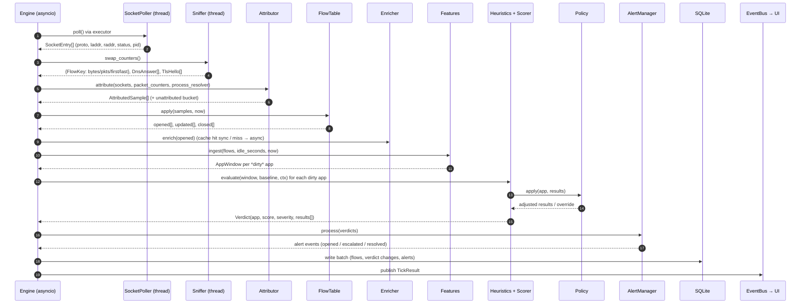
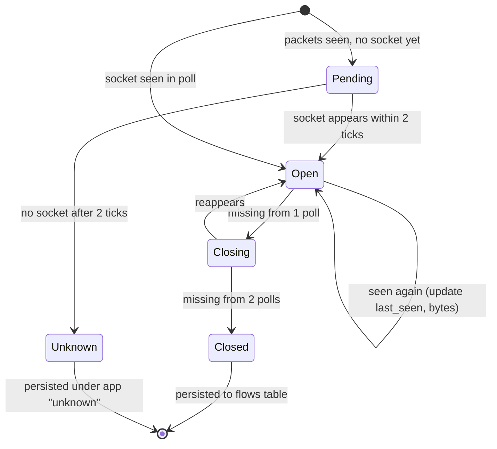
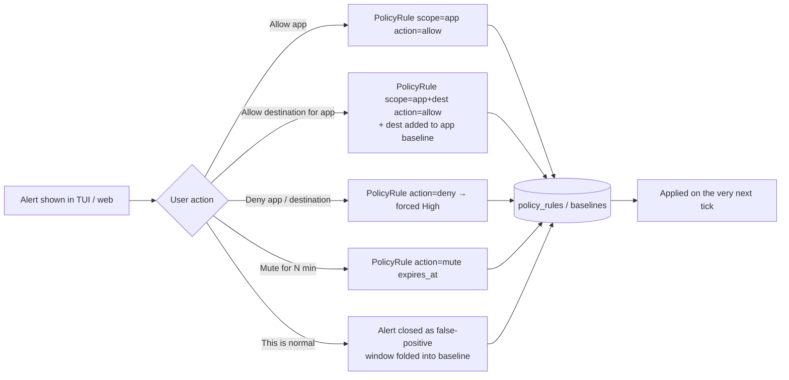

# 2. End-to-End Pipeline

This document follows data from the operating system all the way to a persisted, explained alert, and then back through the user's feedback.

## 2.1 The tick

The engine runs one **tick** every `poll_interval` (default **2 s**). A tick is the unit of work for the whole system.

### Step by step

| # | Stage | What happens | Output |
|---|-------|--------------|--------|
| 1 | **Poll** | `psutil.net_connections("inet")` runs in a worker thread. Loopback entries and `LISTEN` sockets with no remote are dropped (listeners are kept separately, for the "unusual port" view). | `SocketEntry[]` |
| 2 | **Drain sniffer** | Atomically swap the sniffer's counter dict for an empty one. Collect the queued DNS answers and TLS ClientHellos. | packet counters, DNS, TLS events |
| 3 | **Resolve processes** | For each new `(pid, create_time)`, read name, exe, user and cmdline, and walk the parent chain. The result is cached until the process exits. | `ProcessInfo` |
| 4 | **Attribute** | TCP: exact 5-tuple match between packet counters and sockets. UDP: match on `(proto, local_port)`. Unmatched counters wait in a *pending* buffer for 2 ticks, then go to the `unknown` app. | `AttributedSample[]` |
| 5 | **Update flow table** | New key → **open** a flow. Seen again → update `last_seen` and add bytes. Missing for 2 consecutive polls → **close** it. | `opened / updated / closed` |
| 6 | **Enrich** | Find a domain for the remote IP: DNS-answer cache, then the flow's SNI, then the rDNS cache (a miss schedules an async lookup that fills in later). Tag the IP as public, private/LAN or multicast. Optionally look up reputation. | `Flow.domain`, `Flow.ip_class` |
| 7 | **Features** | Add each flow's activity to its app's current **1-minute bucket**. Mark the app as *dirty*. Build the 5-minute sliding window (5 closed buckets + the current partial one). | `AppWindow` |
| 8 | **Heuristics** | Run all 8 heuristics on each dirty app's window against its baseline. Each one returns `score ∈ [0,1]` plus evidence, or `unavailable`. | `HeuristicResult[]` |
| 9 | **Policy** | Allow rules zero out results, deny rules force them up, and mutes suppress alerting while still recording the score. | adjusted results |
| 10 | **Score** | Noisy-OR combination → 0–100 → severity (None / Low / Medium / High). | `Verdict` |
| 11 | **Alerts** | If severity ≥ `alert_min_severity` (default Medium), open or escalate an alert, de-duplicating on `(app, top heuristic)` within the cooldown. When an app stays below threshold for `resolve_after` (5 min), resolve its alert. | `AlertEvent[]` |
| 12 | **Persist** | One SQLite transaction per tick: closed flows, active flow deltas every 30 s, verdicts that changed, and alerts. | rows |
| 13 | **Publish** | Publish a `TickResult` (app table rows, new alerts, stats such as poll ms and pcap drops) on the EventBus. | UI update |

**Time budget per tick** (target < 250 ms of a 2 s interval): poll 30–80 ms, attribution and flow table < 20 ms, features and heuristics < 30 ms for ~100 active apps, and the DB write < 30 ms. The engine logs a warning if a tick goes over budget.

## 2.2 Slower loops

| Loop | Period | Job |
|------|--------|-----|
| Bucket close | 60 s | Freeze the current 1-min bucket for every app and push it into the window ring. |
| Baseline update | on bucket close | Fold each **clean** bucket (verdict below Medium, or user-confirmed as normal) into that app's EWMA. Add its destinations, ports and JA3s to the known sets. Bump the hour-of-day histogram. |
| Baseline persist | 5 min | Write the dirty baselines to SQLite. |
| Retention | 1 h | Delete flows older than `retention_days` (default 7). Alerts are kept. |
| Process cache GC | 30 s | Evict exited `(pid, create_time)` entries. |

## 2.3 Flow lifecycle

## 2.4 Domain resolution order

1. **DNS answer cache** (full mode): the sniffer parses DNS responses and maps each IP to the name that was queried. Entries expire after the answer's TTL, floored at 5 minutes.
2. **TLS SNI** (full mode): the ClientHello of that flow.
3. **Reverse DNS** (both modes): async `socket.gethostbyaddr` in a thread pool, max 4 concurrent, cached for 1 h, with failures cached as `None`.
4. Otherwise the remote is shown as the IP only.

`new_destination` uses the **registrable domain** (`eTLD+1`, via `tldextract` with an offline suffix list) when one is known, so `a1.cdn.example.com` and `a2.cdn.example.com` count as one destination. For bare IPs it falls back to the `/24` (IPv4) or `/48` (IPv6) prefix.

## 2.5 The feedback loop

- Rules are loaded into memory and re-read whenever the DB changes, so a decision takes effect on the **next tick** (≤ 2 s).
- An **allow** never overrides a **blocklist** hit. A known-bad IP is still shown, capped at Medium and labelled "allowed by user". This prevents silent trust.
- **This is normal** is the learning signal. It is the only way an alerted window gets into the baseline, which stops an attacker from slowly poisoning it.
- Every decision is stored with a timestamp and shown in the alert history. That record also feeds the false-positive statistics in the validation report.

## 2.6 Record and replay

`netsentry record --out session.jsonl` writes one JSON line per tick containing the **raw capture inputs**: sockets, process infos, packet counters, DNS/TLS events, idle seconds and the timestamp. `netsentry replay session.jsonl [--speed 10x]` feeds those lines through the same pipeline with a fake clock.

Uses:
- Deterministic integration tests (`tests/fixtures/replays/*.jsonl`).
- Tuning thresholds offline on a real day of traffic.
- A safe demo: if the venue network is bad, replay the attack recordings.
