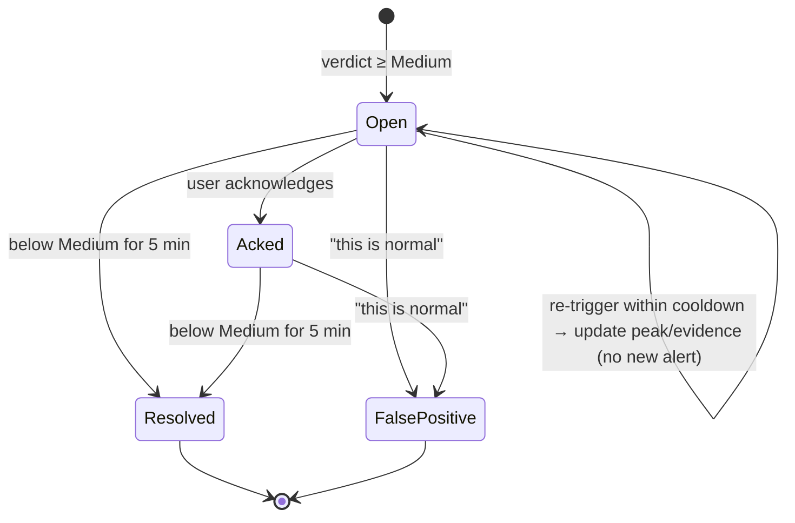

# 4. Detection Engine

Every rule in this document is a function of **features** (what the app is doing now) and its **baseline** (what it normally does). All of the numbers are defaults in `config/rules.yaml`.

## 4.1 Features

The engine rolls flows into **per-app 1-minute buckets**. The *window* is the last 5 closed buckets plus the current partial bucket.

| Feature | Per bucket | Used by |
|---------|-----------|---------|
| `new_flows` | flows opened this minute | frequency |
| `flow_starts[app,dest]` | start timestamps, last 20 per (app, dest), kept across buckets | beacon detection |
| `unique_dests` / `new_dests` | distinct destinations / those not in baseline | new destination |
| `rports` | remote ports used | unusual port |
| `listen_ports` | local ports in `LISTEN` | unusual port |
| `bytes_out`, `bytes_in` | sum over the app's flows *(full mode only)* | volume (`bytes_out` only; `bytes_in` is shown but not scored, so game patches do not trigger it) |
| `ja3n` set | normalised TLS fingerprints *(full mode)* | TLS fingerprint |
| `idle_seconds` | max user-idle time during the minute | off-hours |
| `hour` | local hour of day | off-hours |
| `lineage` | the process's parent chain + exe path | lineage |

A **destination** is the registrable domain (`eTLD+1`) if one is known. Otherwise it is the IP's `/24` (IPv4) or `/48` (IPv6) prefix.

## 4.2 Baselines

Each app (keyed by exe path) has one `Baseline`:

- **EWMA** of `log1p(x)` for `new_flows`, `unique_dests` and `bytes_out`. It updates only on **active** buckets (minutes where the app had any flow), so an app that runs once an hour is compared with its own active minutes, not with zeros.
  `mean ← mean + α·(v − mean)`, `var ← (1−α)·(var + α·(v − mean_old)²)`, α = 0.02 (half-life ≈ 35 active minutes).
- **Known sets**: destinations (with first-seen time and hit count), remote ports, and JA3N hashes.
- **Hour histogram**: 24 counters of active buckets.
- **talker**: true once the app has made any non-loopback connection.
- **Maturity**: the app is *mature* when `n_buckets ≥ 30` **and** `age ≥ learning_period` (default 24 h; 10 min in `--demo` profile).
- **System maturity**: NetSentry itself has been running for at least `learning_period`. A **new app that appears after the system has matured** is suspicious in itself, which closes the "brand-new malware has no baseline" gap.

**Poisoning guard:** a bucket updates the baseline only if the app's verdict during it was below Medium, or the user later marked it "this is normal".

**Statistical deviation** (shared helper):
```
z      = (log1p(x) − mean) / max(sqrt(var), min_std)        # min_std = 0.5
dev(x) = clamp((z − z_lo) / (z_hi − z_lo), 0, 1)            # z_lo = 3, z_hi = 6
```

## 4.3 The eight heuristics

Each heuristic is a pure function `(window, baseline, ctx) → HeuristicResult(score ∈ [0,1] | None, evidence)`. The final score of a heuristic is the **max** over its sub-rules. `None` means *unavailable* (for example, no byte data in standard mode, or an immature baseline).

### H1 · Unusual port usage — weight 0.45
| Sub-rule | Score |
|----------|-------|
| Remote port is in `suspicious_ports` (4444, 1337, 31337, 6666–6669, 5555, 9001, 9030, 12345, 23) | 1.0 |
| Mature app, **TCP** port not in `common_ports` and never used by this app before (UDP is skipped: WebRTC, games and VoIP use random high ports) | 0.5 (0.6 if the port is ≥ 49152) |
| The app opens a new `LISTEN` port it has never listened on, bound to a non-loopback address | 0.5 |

**Inbound** connections (accepted on one of the app's own `LISTEN` ports) are skipped, because their remote port is the client's ephemeral port, not a service.

Evidence example: `connected to 185.x.x.x:4444 (suspicious port: Metasploit default)`

### H2 · Connection frequency spike / beaconing — weight 0.55
| Sub-rule | Score |
|----------|-------|
| **Rate:** `dev(new_flows)` for the current minute, and only if `new_flows ≥ 10` (mature apps) | 0…1 |
| **Beacon:** for any (app, remote ip:port) with ≥ 6 recorded starts in the last 5 min, `cv = std/mean` of the inter-arrival times. `cv ≤ 0.10` → 1.0, `cv ≥ 0.35` → 0, linear in between. The score is ×0.3 if the dest is already known to a mature app (heartbeats such as Teams or Slack are normal) **or** while NetSentry is still learning (otherwise every heartbeat would alert on day one). | 0…1 |

In standard mode, start times come from the 2 s polls, so only intervals ≥ 10 s are trusted. In full mode, SYN timestamps are exact.

Evidence example: `7 connections to 203.0.113.9 every 30.1 s ± 0.9 s (cv 0.03)`

### H3 · New / unrecognised destination — weight 0.35
| Sub-rule | Score |
|----------|-------|
| Mature app talks to destinations not in its baseline: `0.5 + 0.1·(n_new − 1)`, capped at 0.8 | 0.5–0.8 |
| +0.2 if the destination has **no name at all** (direct-to-IP: no DNS, SNI or rDNS) | |
| ×0.5 if the destination is private/LAN | |
| **New app after system maturity**: first time this exe has ever used the network | 0.5 (+0.2 direct-to-IP) |
| System still learning | `None` (destinations are recorded silently) |

Evidence example: `first contact with evil-cdn.xyz (no prior history for this app)`

### H4 · Data volume anomaly — weight 0.60 *(full mode only)*
Let `x = max(bytes_out(current minute), bytes_out(last closed minute))`.
Score = `dev(x)`, but only if `x ≥ min_bytes_out` (5 MB/min). This stops a tiny app jumping from 1 KB to 50 KB from triggering it.
For a **new app after system maturity** (no baseline yet), use an absolute rule instead: `x ≥ 50 MB/min` → 0.7.

Evidence example: `uploaded 212 MB in 1 min; baseline ≈ 0.8 MB/min (z = 11.4)`

### H5 · Known-bad IP / domain — weight 0.95, **hard override**
| Sub-rule | Score |
|----------|-------|
| Remote IP in `blocklists/ips.txt` (IP or CIDR) | 1.0 |
| Domain, or any parent domain, in `blocklists/domains.txt` | 1.0 |
| *(stretch)* AbuseIPDB confidence ≥ 75 / 25–74 | 0.9 / 0.5 |

Any hit raises the final score to at least **80 (High)**, whatever the other heuristics say.

### H6 · Off-hours activity — weight 0.25 (amplifier)
This only applies when the app's current bucket is *significant* (`new_flows ≥ 3` or `bytes_out ≥ 1 MB`).
| Sub-rule | Score |
|----------|-------|
| User idle ≥ 10 min (`GetLastInputInfo`) | 0.6 |
| Hour falls in `quiet_hours` (default 01:00–06:00), **or** a mature app's `hour_hist` share for this hour < 2 % | 0.6 |
| Both of the above | 1.0 |

Its weight is low on purpose. On its own it can reach Low at most, but it pushes a real anomaly up a severity level.

### H7 · Suspicious process lineage — weight 0.60
| Sub-rule | Score |
|----------|-------|
| **Masquerading**: name matches a system binary (`svchost.exe`, `lsass.exe`, `csrss.exe`, `services.exe`, `explorer.exe`, …) but the exe is not under `C:\Windows\System32` or `SysWOW64` | 1.0 |
| **Suspicious parent → child**: Office, PDF reader or browser → script host / LOLBin (`powershell`, `pwsh`, `cmd`, `wscript`, `cscript`, `mshta`, `rundll32`, `regsvr32`, `certutil`, `bitsadmin`) making an external connection | 1.0 |
| Script host / LOLBin making an external connection with any parent | 0.5 |
| Exe runs from a user-writable staging path (`%TEMP%`, `\Downloads\`, `\AppData\Local\Temp\`, `\Users\Public\`) | 0.6 |
| *(stretch)* exe has no valid Authenticode signature | 0.3 |

The lists live in `config/lolbins.yaml`. Evidence example: `WINWORD.EXE → powershell.exe → 198.51.100.4:443`

### H8 · TLS fingerprint — weight 0.35 *(full mode only)*
| Sub-rule | Score |
|----------|-------|
| JA3 or JA3N is in `blocklists/ja3.txt` (e.g. the abuse.ch SSLBL list) | 1.0 |
| Mature app presents a JA3N it has never used before, i.e. its TLS client stack changed | 0.5 |

This catches a process that normally uses Windows SChannel suddenly speaking with an embedded Go or Python TLS client. **Known false positive:** app updates that change the TLS library. The weight is low for that reason.

## 4.4 Combining: noisy-OR

```
S     = 1 − Π_i (1 − w_i · s_i)          over available heuristics, s_i ∈ [0,1]
score = round(100 · S)
```

A weight `w_i` means "the most this signal alone can contribute". Independent signals reinforce each other, and the formula never goes above 100. Unavailable heuristics are simply skipped.

| Score | Severity | Behaviour |
|-------|----------|-----------|
| 0–24 | **None** | shown in table, no colour |
| 25–49 | **Low** | yellow in table, no alert |
| 50–74 | **Medium** | alert opened |
| 75–100 | **High** | alert opened + desktop toast *(stretch)* |

### Overrides (applied in this order)
1. **Deny rule** matches the app or dest → score = max(score, 90).
2. **Blocklist hit** (H5) → score = max(score, 80). If the app is *allowed* by the user, it is capped at 60 instead and labelled `allowed-but-blocklisted`.
3. **Allow rule** (app, or app+dest) → only the matching flows' results are zeroed out. A whole-app allow sets the score to 0, shown as `allowed`.
4. **Mute** → the score is computed and shown, but no alert is opened.

### Worked examples (these become unit tests)
| Scenario | Heuristics firing (w·s) | S | Result |
|----------|------------------------|---|--------|
| Background app uploads 200 MB to a new bare IP at 3 AM while you sleep | H4 0.6·1.0, H3 0.35·0.7, H6 0.25·1.0 | 1 − 0.40·0.755·0.75 = 0.77 | **77 High** |
| C2 beacon every 30 s to a bare IP on :4444 | H2 0.55·1.0, H1 0.45·1.0, H3 0.35·0.7 | 1 − 0.45·0.55·0.755 = 0.81 | **81 High** |
| Word spawns PowerShell that downloads from a new domain | H7 0.6·1.0, H3 0.35·0.5 | 1 − 0.40·0.825 = 0.67 | **67 Medium** |
| Chrome opens a site you have never visited | H3 0.35·0.5 | 0.175 | **18 None** |
| OneDrive uploads a large folder in the afternoon | H4 0.6·1.0 | 0.60 | **60 Medium** — a false positive, fixed with "this is normal" |
| Any app hits a blocklisted IP | H5 0.95 | ≥ 0.95 | **95 High** |

## 4.5 Alert lifecycle



There is **one active alert per app per incident**. While the app stays ≥ Medium, the alert is updated in place (peak score, top heuristic, evidence). If the same app flares up again within the 15 min cooldown after resolving, the old alert is reopened instead of a new one. An alert's `summary` is built from its top two evidence strings, for example:
`"backup.exe uploaded 212 MB in 1 min to 203.0.113.9 (new destination) while you were idle"`.

## 4.6 `config/rules.yaml` (default)

```yaml
version: 1
engine:
  poll_interval_s: 2
  bucket_s: 60
  window_buckets: 5
  learning_period_h: 24          # demo profile: 0.17 (10 min)
  min_buckets_mature: 30
  include_lan: true
  ignore_loopback: true
baseline:
  ewma_alpha: 0.02
  min_std: 0.5
  z_lo: 3
  z_hi: 6
severity:
  low: 25
  medium: 50
  high: 75
  alert_min: medium
  resolve_after_s: 300
  dedupe_cooldown_s: 900
heuristics:
  unusual_port:     { enabled: true, weight: 0.45 }
  frequency:        { enabled: true, weight: 0.55, min_new_flows: 10, beacon_min_events: 6, cv_full: 0.10, cv_zero: 0.35, known_dest_factor: 0.3 }
  new_destination:  { enabled: true, weight: 0.35, direct_ip_bonus: 0.2, lan_factor: 0.5 }
  volume:           { enabled: true, weight: 0.60, min_bytes_out_per_min: 5_000_000, new_app_abs_bytes: 50_000_000 }
  blocklist:        { enabled: true, weight: 0.95, override_min_score: 80, files: [blocklists/ips.txt, blocklists/domains.txt] }
  off_hours:        { enabled: true, weight: 0.25, idle_threshold_s: 600, quiet_hours: ["01:00", "06:00"], min_hour_share: 0.02 }
  lineage:          { enabled: true, weight: 0.60, lists: lolbins.yaml }
  tls_fingerprint:  { enabled: true, weight: 0.35, bad_list: blocklists/ja3.txt }
reputation:
  enabled: false
  provider: abuseipdb
  api_key_env: ABUSEIPDB_API_KEY  # read from env, never from this file
  daily_budget: 900
```

## 4.7 Future: replacing the scorer
The `Scorer` interface is `score(results, features, baseline) → Verdict`. An **Isolation Forest** scorer trained on the `app_minutes` table can drop in behind it without touching capture or UI. The rule-based scorer stays as the explanation layer, and the model only adjusts the ranking.
