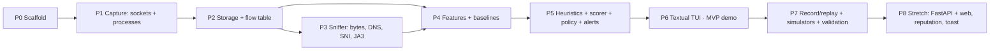

# 6. Build Plan

Build in this order: **capture → storage → correlation → detection → UI → stretch**. Each phase ends with something runnable and a check that passes. Never start detection logic before real data is flowing into the DB.

| Phase | Deliverable | Done when |
|-------|-------------|-----------|
| **P0 · Scaffold** | `pyproject.toml`, package skeleton, `models.py`, `config.py` with `rules.yaml` validation, `clock.py`, `netsentry doctor`, ruff, pytest | `netsentry doctor` reports Python, admin state, Npcap presence and config validity. `pytest` is green. |
| **P1 · Capture (standard mode)** | `SocketPoller`, `ProcessResolver` (with lineage), `IdleMonitor`, `netsentry capture --dump` | With a browser on two known sites, the dump shows `chrome.exe` → their IPs on :443. PIDs match `netstat -ano`. System PIDs degrade to `pid:N` without crashing. |
| **P2 · Storage + flow table** | `schema.sql`, `Store`, `StorageWriter`, `Attributor` (socket-only path), `FlowTable`, `Engine.tick()` running steps 1–5 + 12 | After 10 min of `run --ui none`, `flows` has open/closed rows with correct timestamps. Killing and restarting the process loses ≤ 30 s of data. |
| **P3 · Sniffer (full mode)** | `PacketSniffer`, `tls.py`, `dns.py`, attribution of packet counters, `Enricher` (DNS → SNI → rDNS) | Downloading a 100 MB file shows ≈ 100 MB `bytes_in` on the right process (±10 %). `domain` is filled for > 90 % of browser flows. JA3 unit tests pass. Without admin, the engine falls back to standard mode cleanly. |
| **P4 · Features + baselines** | `FeatureExtractor`, buckets, window, `Baseline` (EWMA, known sets, hour hist, maturity), persistence, poisoning guard | `app_minutes` fills every minute. Baselines survive a restart. The learning countdown is visible in logs. |
| **P5 · Detection** | 8 heuristics, `Scorer`, `PolicyEngine`, `AlertManager`, worked-example tests | All doc 4.4 examples pass as unit tests. A replayed synthetic beacon produces exactly one HIGH alert with top heuristic `frequency`. |
| **P6 · TUI (MVP)** | Textual app table + alert pane + detail screen + allow/deny/mute/normal keys | End-to-end live demo: run a simulator → alert appears within 1 min. Pressing `n` suppresses it on the next tick, and that is visible in `user_actions`. |
| **P7 · Validation** | `record`/`replay`, `tools/simulate/*`, `export`, results tables | Every scenario in doc 7 has been run, with TP/FP numbers recorded. A demo replay file is committed. |
| **P8 · Stretch** | FastAPI + WS, React dashboard with per-app history charts, AbuseIPDB enrichment, desktop toast for HIGH, optional "block with Windows Firewall" (asks for confirmation; admin) | Each item is independent, so pick them by the time left. |

## Milestone mapping to the DA2 objectives

| DA2 objective | Satisfied by |
|---------------|--------------|
| Capture connections + attribute to process (PID + exe) | P1, P3 |
| Log metadata: destination, port, protocol, volume, frequency | P2, P3, P4 |
| Rule-based heuristic engine | P5 |
| Dashboard / CLI with severity + per-app history | P6 (P8 adds the web view) |
| Whitelist / blacklist | P5 policy + P6 keys |
| Honest validation, TP and FP | P7 |

## Status (2026-10-20)

| Phase | State |
|-------|-------|
| P0–P6 | ✅ done. 54 tests green. Live standard-mode run verified on the dev laptop. |
| P3 full mode | ✅ implemented and unit-tested (TLS/DNS parsing). Still needs a live run from an elevated terminal (V2/V3 in doc 7). |
| P7 | 🟡 simulators, record/replay and export done. The live beacon simulation is measured; the rest of doc 7 and the normal-day FP study are still to run. |
| P8 | ⬜ not started |

Repository: https://github.com/Nainikap/mycafee (package name `netsentry`).
